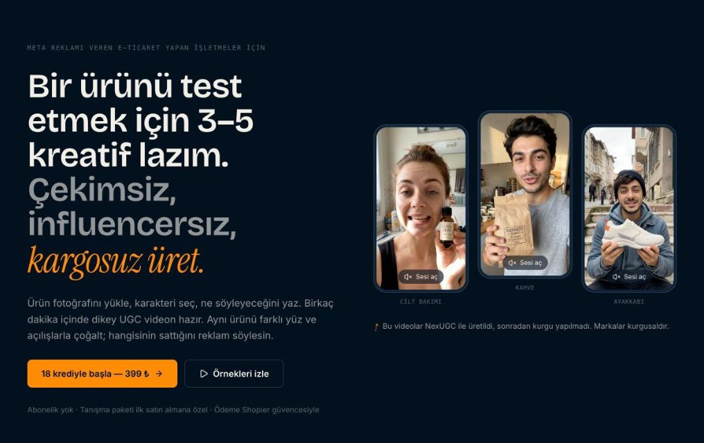
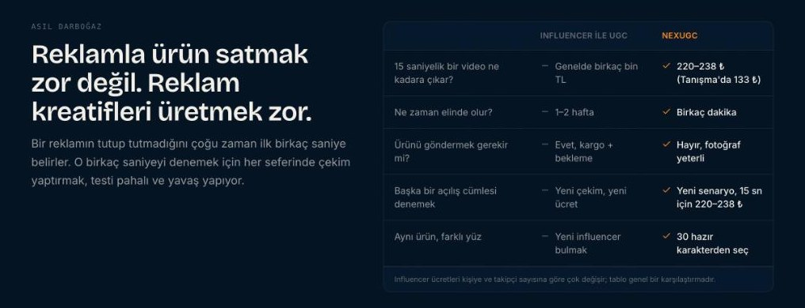
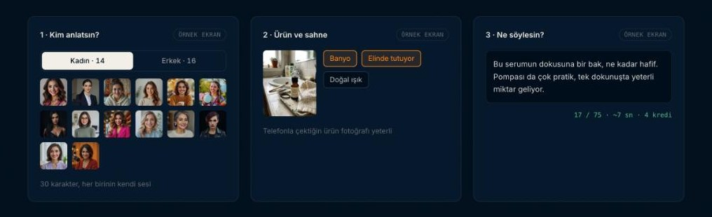
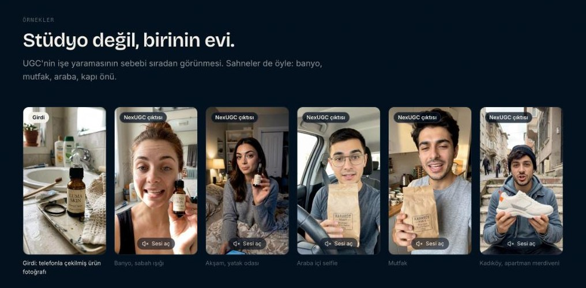
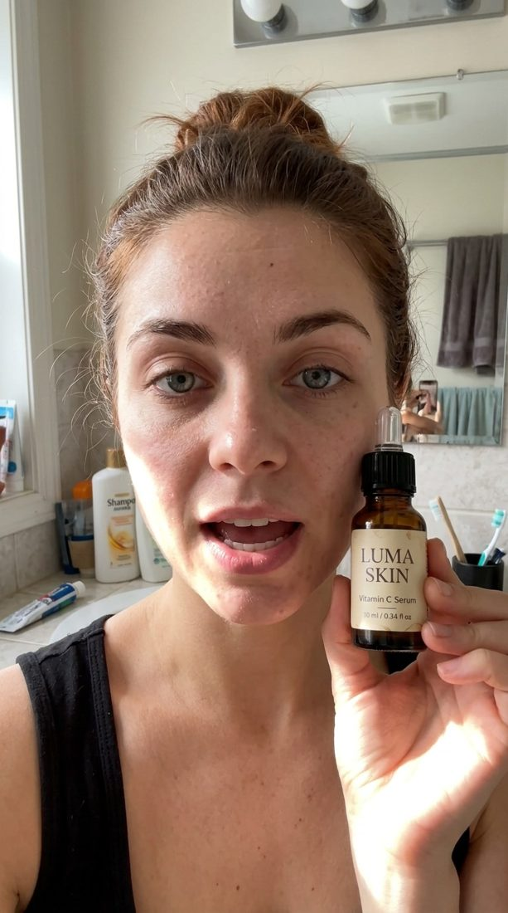
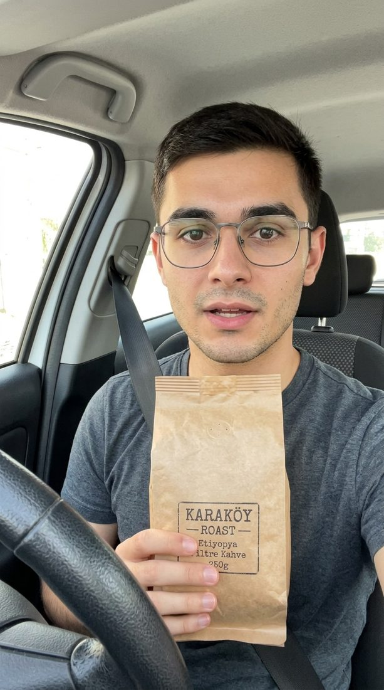
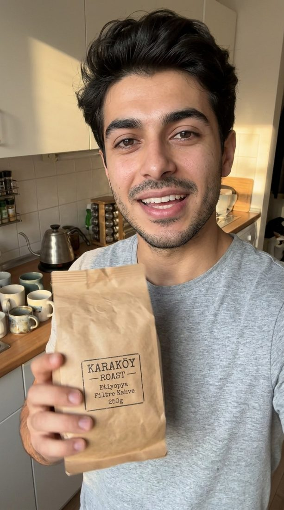
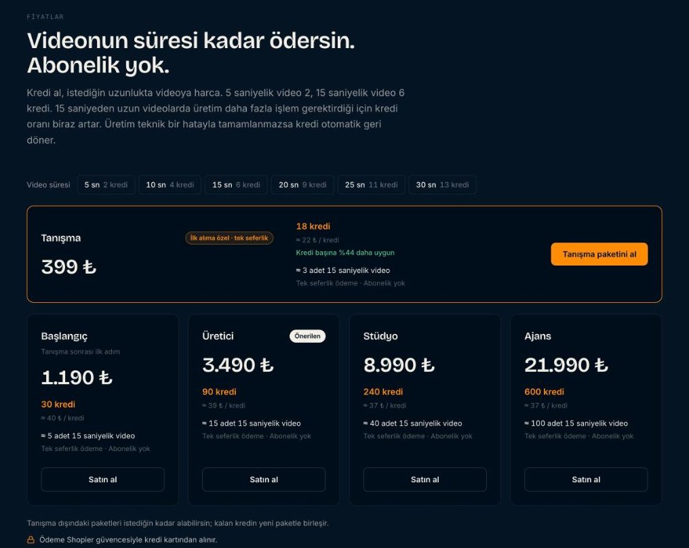

<div align="center">

# NexUGC

**Meta reklamı veren e-ticaret yapan işletmeler için yapay zeka UGC videoları.**

Ürün fotoğrafını yükle, karakteri seç, ne söyleyeceğini yaz. Birkaç dakika içinde dikey, Türkçe konuşan bir UGC videon hazır.

[nexugcapp.com](https://www.nexugcapp.com) · [Ekran görüntüleri](#ekran-görüntüleri) · [Fiyat modeli](#fiyat-modeli) · [Proje yapısı](#proje-yapısı)




</div>

---

## Neden?

Bir ürünün reklamda tutup tutmadığını çoğu zaman ilk birkaç saniye belirler. O birkaç saniyeyi denemek için her seferinde influencer bulmak, ürün kargolamak ve çekim beklemek testi pahalı ve yavaş yapıyor.

NexUGC aynı ürünü farklı yüzlerle, farklı mekânlarda ve farklı açılış cümleleriyle dakikalar içinde çoğaltır. Hangisinin sattığını reklam yöneticisi söyler.

| | Influencer ile UGC | NexUGC |
|---|---|---|
| Ne zaman elinde olur? | 1–2 hafta | Birkaç dakika |
| Ürünü göndermek gerekir mi? | Evet, kargo + bekleme | Hayır, fotoğraf yeterli |
| Başka bir açılış cümlesi denemek | Yeni çekim, yeni ücret | Yeni senaryo |
| Aynı ürün, farklı yüz | Yeni influencer bulmak | 30 hazır karakterden seç |

## Ekran görüntüleri

**Asıl darboğaz ve karşılaştırma**



**Bir video nasıl hazırlanır:** karakter seç, ürünü ve sahneyi belirle, senaryoyu yaz. Sayaç senaryonun süresini ve kaç kredi tutacağını yazarken gösterir.



**Örnekler:** ilk kart girdi olan ürün fotoğrafı, diğerleri uygulamanın ürettiği videolar. Videolar yalnızca ekranda görünürken oynar; üzerine gelince ya da dokununca ses açılır.



<table>
  <tr>
    <td></td>
    <td></td>
    <td></td>
    <td></td>
    <td></td>
  </tr>
  <tr>
    <td align="center">Banyo</td>
    <td align="center">Yatak odası</td>
    <td align="center">Araba içi</td>
    <td align="center">Mutfak</td>
    <td align="center">Merdiven</td>
  </tr>
</table>

> Görsellerdeki markalar (Luma Skin, Karaköy Roast) kurgusaldır.

## Özellikler

- **30 Türkçe konuşan karakter** (14 kadın, 16 erkek), her birinin kendi sesi ve konuşma tarzı
- **Süreye göre kredi:** video ne kadar uzunsa o kadar kredi harcanır; tutar senaryo yazılırken gösterilir ve sunucuda yeniden hesaplanır
- **Dikey 9:16 çıktı:** Reels, Stories ve TikTok'a hazır, filigransız
- **Mekâna göre ortam sesi:** dış mekân sahnelerinde konuşmanın altına mekâna uygun ortam sesi eklenir
- **Başarısız üretimde otomatik iade:** kredi üretim başlarken ayrılır, teknik hatada bakiyeye geri döner
- **Kombinasyon hesaplayıcı:** farklı uzunlukta videolar için kaç kredi gerektiğini ve hangi paketin yettiğini gösterir
- **Türkçe / İngilizce arayüz**, mobil uyumlu tasarım

## Fiyat modeli

Tüm fiyat, kredi ve video adedi tek bir dosyadan hesaplanır: [`src/lib/pricing.ts`](src/lib/pricing.ts). Sayfadaki hiçbir sayı elle yazılmaz.

| Süre | 5 sn | 10 sn | 15 sn | 20 sn | 25 sn | 30 sn |
|---|---:|---:|---:|---:|---:|---:|
| Kredi | 2 | 4 | 6 | 9 | 11 | 13 |

| Paket | Fiyat | Kredi | ≈ 15 sn video |
|---|---:|---:|---:|
| Tanışma (ilk alıma özel, bir kez) | 399 ₺ | 18 | 3 |
| Başlangıç | 1.190 ₺ | 30 | 5 |
| Üretici | 3.490 ₺ | 90 | 15 |
| Stüdyo | 8.990 ₺ | 240 | 40 |
| Ajans | 21.990 ₺ | 600 | 100 |



## Proje yapısı

```
src/
├── app/
│   ├── page.tsx                 # Ana sayfa (hero, karşılaştırma, örnekler, fiyatlar, SSS)
│   ├── create/                  # Video oluşturma ekranı
│   ├── dashboard/               # Kreatif kütüphanesi
│   ├── auth/                    # Giriş / kayıt
│   └── (yasal sayfalar)         # Mesafeli satış, iade, KVKK, gizlilik, kullanım koşulları
├── components/
│   ├── pricing-plans.tsx        # Paket kartları ve kombinasyon hesaplayıcı
│   ├── showcase-video.tsx       # Görünürken oynayan, sesi açılabilen video
│   └── ui.tsx                   # Tasarım sistemi bileşenleri
└── lib/
    ├── pricing.ts               # Süre → kredi tablosu, paketler, türetilmiş değerler
    ├── script-limits.ts         # Senaryo kelime sınırı ve süre tahmini
    └── i18n.tsx                 # TR / EN dil desteği
public/
├── avatars/                     # Karakter portreleri
└── showcase/                    # Örnek videolar ve kareler
```

## Bu depoda olmayanlar

Bu depo arayüzün ve tasarımın herkese açık kopyasıdır. Şunlar bilerek dışarıda bırakıldı:

- Ödeme entegrasyonu ve sipariş eşleştirme
- Video üretim hattı, API rotaları ve sunucu tarafı servisler
- Veritabanı şeması ve fonksiyonları
- Karakterlerin ses ayarları ve prompt mantığı (bu depodaki `presets.ts` ve `prompt-builder.ts` boş sürümlerdir)

Bu yüzden proje derlenir ve arayüz yerelde açılır, ama video üretimi ve ödeme çalışmaz.

## Yerelde çalıştırma

```bash
npm install
cp .env.example .env.local   # Supabase proje adresini ve anon anahtarını gir
npm run dev
```

Ardından [http://localhost:3000](http://localhost:3000) adresini aç.

## Lisans

© 2026 NexUGC. Tüm hakları saklıdır. Kod inceleme amaçlı paylaşılmıştır; izin alınmadan kopyalanamaz, dağıtılamaz veya ticari olarak kullanılamaz.
